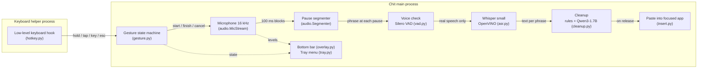

# How Chit works

Chit is a Python desktop app for Windows. Everything below runs on the user's computer; the
only network access is the one-time model download during first-run setup.

## Pipeline

1. **Hotkey.** A low-level keyboard hook runs in its own small process, so nothing the main app
   does can slow it down enough for Windows to drop it. Caps Lock presses go straight to
   Windows (a tap is a normal Caps Lock). If the key is still held after 0.4 s, the helper
   switches Caps Lock back, swallows the rest of the press and tells the app to start.
2. **Gestures.** A pure state machine turns helper events into actions: hold to talk,
   double-tap for hands-free, double-tap again to finish, Esc to cancel, click the bar to
   start/finish.
3. **Audio.** The mic opens only when dictation starts. 100 ms blocks feed a segmenter that
   cuts a phrase at each ~0.6 s pause, so phrases are transcribed *while you are still
   talking*.
4. **Voice check.** Each phrase must contain at least 0.3 s of real voice (Silero VAD), or it
   is dropped. This stops keyboard clicks and room noise from becoming words.
5. **Speech recognition.** Whisper *small* (int8, OpenVINO) on the fastest device for this PC.
   The language is fixed per dictation (English by default).
6. **Cleanup.** When you finish, the phrases are joined and cleaned: *Light* = rules (fillers,
   stutters, capitals, final punctuation); *Smart* = rules, then a Qwen3-1.7B rewrite that
   applies self-corrections and fixes grammar. Guards reject a rewrite that answers instead of
   transcribing, adds or drops content, loses a number, comes back garbled, or takes too long;
   the rule-based result is used instead.
7. **Insertion.** The text is put on the clipboard, Ctrl+V is sent to the focused app, and the
   previous clipboard text is restored (classic consoles get typed input instead).

## Threads and processes

| Where | What runs there |
| --- | --- |
| Keyboard helper process | The hook (`hotkey.hook_main`), plus the 0.4 s hold timer |
| Main thread | Tk event loop for the bottom bar (`overlay.Overlay`) |
| `control` thread | Gesture state machine, mic stream, segmenter, timers (hands-free auto-stop after 60 s without voice, 10-minute cap, mic-stall watchdog) |
| `worker` thread | VAD + Whisper per phrase; cleanup + paste when a dictation finishes |
| `loader` thread | Loads the models at startup without blocking the UI |
| Tray thread | pystray icon and menu |

All recording-state changes happen on the `control` thread, in order, so key events, clicks,
timers and audio never race each other.

## Modules (`src/chit/`)

| Module | Responsibility |
| --- | --- |
| `app.py` | Entry point (`main`), single-instance check, the `App` that wires everything together |
| `hotkey.py` | Keyboard helper process; `TriggerKey` decides per event whether Windows sees it |
| `gesture.py` | Caps Lock gesture state machine (pure, unit-tested) |
| `audio.py` | Mic capture, `Segmenter`, WAV loading, input device list |
| `vad.py` | Silero VAD via ONNX Runtime (telemetry disabled) |
| `asr.py` | Whisper through OpenVINO GenAI; hallucination filter; language pinning |
| `cleanup.py` | Light rules, Smart LLM rewrite, and the safety guards |
| `insert.py` | Clipboard paste with restore |
| `overlay.py` | The bottom bar: per-pixel-alpha layered window, never takes focus |
| `tray.py` | Tray icon and menu, start-at-login registry value, the author stamp |
| `setup_ui.py` | First-run window: download progress, then device benchmark |
| `bench.py` | Times each model on CPU / GPU / NPU and keeps the fastest; manages compiled caches |
| `models.py` | Model IDs and the Hugging Face download (the only network code) |
| `config.py` | Settings JSON with defaults and migrations |
| `icon.py` | The logo, drawn as vector shapes for every size and theme |
| `sounds.py` | Start/stop chimes synthesized in memory |
| `paths.py`, `log.py` | Data locations and logging (dictated text is never logged by default) |

## Device choice

On first run `bench.py` loads each model on every available OpenVINO device (CPU, integrated
GPU, Intel NPU), times a short sample, and keeps the fastest. On a near-tie (within 10%) it
prefers the NPU. Only the NPU keeps a compiled-model cache (compiling there takes ~45 s);
CPU/GPU compile in seconds at each start. If the chosen device fails to load later, Chit falls
back to the CPU.

## Files on disk

| Path | Contents |
| --- | --- |
| `%LOCALAPPDATA%\Programs\Chit` | The installed app |
| `%LOCALAPPDATA%\Chit\models` | Downloaded models (~1.4 GB) |
| `%LOCALAPPDATA%\Chit\ov-cache` | Compiled NPU models |
| `%LOCALAPPDATA%\Chit\settings.json` | Settings |
| `%LOCALAPPDATA%\Chit\chit.log` | Log (no dictated text unless `debug_log` is enabled in settings) |
| `HKCU\...\CurrentVersion\Run` → `Chit` | Start at sign-in |

## Packaging

`packaging/build.ps1` runs the tests, builds `Chit.exe` with PyInstaller (`packaging/chit.spec`,
one-folder, windowed) and the per-user installer with Inno Setup (`packaging/installer.iss`).
The version comes from `src/chit/__init__.py`.
